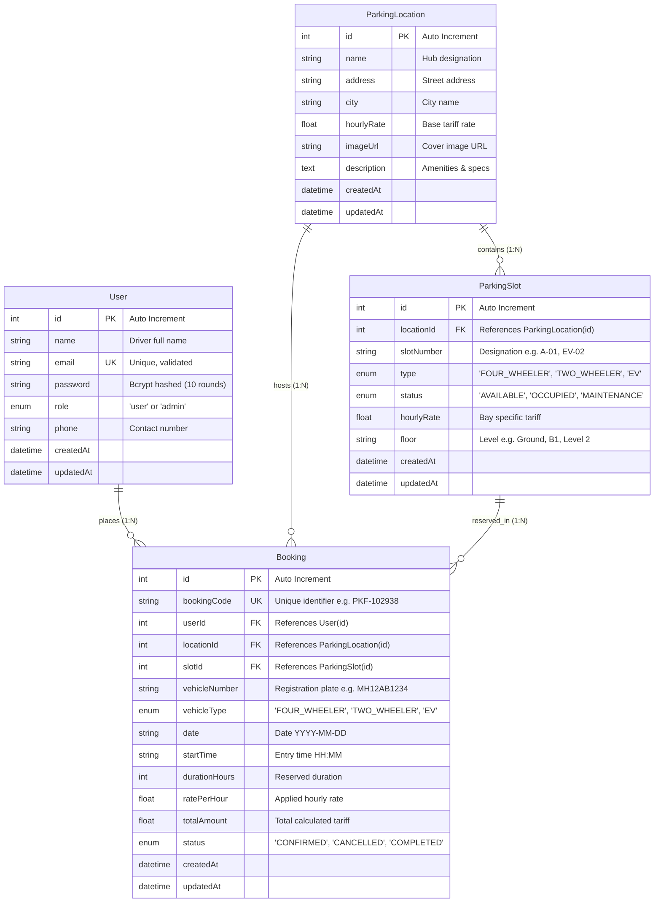

# PARKIFY Database Architecture & Entity Relationship (ER) Schema

This document outlines the relational database schema implemented in PARKIFY (Program 5) with Sequelize ORM, targeting PostgreSQL (production) and SQLite (zero-config local runtime).

---

## 1. Entity Relationship (ER) Diagram

---

## 2. Table Specifications & Database Constraints

### 2.1 Table: `users`
| Column | Type | Constraints | Description |
| :--- | :--- | :--- | :--- |
| `id` | INTEGER | PRIMARY KEY, AUTO_INCREMENT | Unique user identifier |
| `name` | VARCHAR(255) | NOT NULL | User's full name |
| `email` | VARCHAR(255) | NOT NULL, UNIQUE | User login email |
| `password` | VARCHAR(255) | NOT NULL | Salted bcrypt hash |
| `role` | ENUM('user', 'admin') | DEFAULT 'user' | Access control level |
| `phone` | VARCHAR(50) | NULLABLE | Contact telephone |
| `createdAt` | DATETIME | NOT NULL | Timestamp of creation |
| `updatedAt` | DATETIME | NOT NULL | Timestamp of last update |

### 2.2 Table: `parking_locations`
| Column | Type | Constraints | Description |
| :--- | :--- | :--- | :--- |
| `id` | INTEGER | PRIMARY KEY, AUTO_INCREMENT | Unique hub identifier |
| `name` | VARCHAR(255) | NOT NULL | Facility title |
| `address` | VARCHAR(255) | NOT NULL | Street location |
| `city` | VARCHAR(100) | NOT NULL | City jurisdiction |
| `hourlyRate` | FLOAT | NOT NULL, DEFAULT 50.0 | Base hourly fee in ₹ |
| `imageUrl` | VARCHAR(500) | NULLABLE | Facility photo |
| `description` | TEXT | NULLABLE | Facility details |

### 2.3 Table: `parking_slots`
| Column | Type | Constraints | Description |
| :--- | :--- | :--- | :--- |
| `id` | INTEGER | PRIMARY KEY, AUTO_INCREMENT | Slot identifier |
| `locationId` | INTEGER | NOT NULL, FK -> `parking_locations(id)` | Parent parking facility |
| `slotNumber` | VARCHAR(50) | NOT NULL | Physical slot designation |
| `type` | ENUM | DEFAULT 'FOUR_WHEELER' | Vehicle bay type |
| `status` | ENUM | DEFAULT 'AVAILABLE' | Real-time bay occupancy |
| `hourlyRate` | FLOAT | NOT NULL | Applied tariff |
| `floor` | VARCHAR(50) | DEFAULT 'Ground' | Floor or parking deck level |

### 2.4 Table: `bookings`
| Column | Type | Constraints | Description |
| :--- | :--- | :--- | :--- |
| `id` | INTEGER | PRIMARY KEY, AUTO_INCREMENT | Internal booking key |
| `bookingCode`| VARCHAR(50) | NOT NULL, UNIQUE | Customer ticket/pass code |
| `userId` | INTEGER | NOT NULL, FK -> `users(id)` | Reserving driver |
| `locationId` | INTEGER | NOT NULL, FK -> `parking_locations(id)` | Reserved location |
| `slotId` | INTEGER | NOT NULL, FK -> `parking_slots(id)` | Reserved bay |
| `vehicleNumber`| VARCHAR(50) | NOT NULL | Vehicle registration |
| `vehicleType`| ENUM | NOT NULL | Category of vehicle |
| `date` | VARCHAR(20) | NOT NULL | Reservation date |
| `startTime` | VARCHAR(10) | NOT NULL | Arrival time |
| `durationHours`| INTEGER | NOT NULL, MIN 1, MAX 24 | Duration in hours |
| `ratePerHour`| FLOAT | NOT NULL | Rate applied |
| `totalAmount`| FLOAT | NOT NULL | Total tariff charged |
| `status` | ENUM | DEFAULT 'CONFIRMED' | Booking lifecycle state |

---

## 3. Database Transaction & Concurrency Controls
To guarantee zero double-bookings under concurrent client requests:
1. `sequelize.transaction()` wraps every booking creation.
2. Inside the transaction boundary, a SQL query checks for an existing `CONFIRMED` booking matching `slotId` and `date`.
3. If an overlapping booking is detected, the transaction immediately rolls back and returns HTTP `409 Conflict`.
4. If no conflict exists, the booking record is created, the slot state is atomically toggled to `OCCUPIED`, and the transaction is committed.
